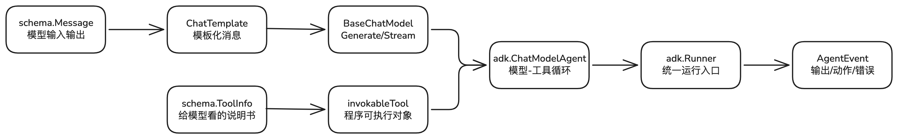

# 基础概念

1、Agent是把模型Model、工具Tools、记忆Memory、知识Knowledge，RAG、计划Planing、循环Loop 组织起来的**应用结构**，跟”换一个模型"
不是一回事。

2、ReAct=思考Thought-Model、行动Action-Tools、观察Observation-Memory,Knowledge、汇总Final

3、Planing画路线图 ReAct执行每一步

4、Plan-and-Execute

- Planner：一次性生成完整计划（通常是一次模型调用，Prompt 专注拆解）
- Executor：按计划逐步执行（可以是另一个 Agent，也可以是一组工具调用）
- Replanner：执行过程中出问题了，回头调整后续步骤

5、高级Planing

- Tree of
  Thoughts（思维树）：在每一步生成多个候选思路，给每个思路打分，只保留得分最高的几个继续往下想。适合“答案质量比成本重要"
  的场景，比如系统架构设计、关键决策分析。
- Reflection（反思 /自我审视）：让 Agent 生成方案后，再用一个"Critic"角色挑毛病，反复迭代直到通过。Generator + Critic 是常见的双
  Agent 配合方式。

6、Memory

- Session 短期记忆，当前会话 短期上下文 -- 最近这一轮聊了什么
- Profile 用户画像，长期记忆 长期、跨会话 -- 用户身份，水平，目标，阶段等
- Summary 摘要记忆，最近摘要 压缩出来的状态 -- 最近卡点，给过的建议，下一步等
- 请求流程
    - 从DB 拉 Profile
    - 从 DB 拉最近一次 Summary
    - 从内存 / 短期表里拉当前 Session 的最近几轮
    - 拼成 Prompt -> 调模型
    - 模型回答完，看是否需要更新 Summary 或 Profile
    - 写回 DB
- 注意细节
    - 画像不是越多越好。早期项目能就5个字段不要写20个。字段越多，模型注意力越分散，反而效果不好.
    - 画像可能跟新行为冲突。比如画像说“新手”，但用户最近开始问"goroutine
      调度”。这时候要么信用户当下的提问（即时优先），要么保留画像但在提示里加一句“如果实际水平已变化，请按实际水平回答”。我倾向后者，因为用户的提问可能只是好奇，不代表他真懂。
    - 摘要要定期老化。一周前的"卡在GQRM. 报错”“可能早解决了，再拼进去就是干扰。给摘要加 UpdatedAt，超过一定时间就重新摘要或清空.
    - 别什么都往长期画像里塞。“今天天气真好”这种闲聊不要写进画像。能写进画像的，是用户的稳定信息—一身份、目标、长期偏好。

7、ToolUse

- **模型是决策者** 决定调不调，调哪个，传参数等 **程序是执行者** 真正的去和外部世界打交道，和数据打交道
- 模型本身不会调用任何工具，模型本身是一个文本生成器，输入一段文本，返回一段文本，所谓调用工具是模型输出了一段结构化的json，真正执行Http请求，读文件，跑命令的是Go程序本身
- 工具不能无限添加，选择越多，决策越费劲，工具数量增加
  考虑分组（项目相关工具，邮件相关工具）、动态工具检索，返回相关性高的、多Agent架构，每个agent只负责一个组的工具，由一个总管Agent分发任务
- 工具要有安全边界，工具能执行 rm -rf，转账，发邮件等功能需谨慎， 需加白名单，加参数校验，加人工确认等

# Eino

1、流程

- Message 是数据单元
- ChatTemplate 解决消息怎么动态拼
- ChatModel 解决怎么调模型
- ToolInfo 解决怎么把工具介绍给模型
- InvokableTool 解决程序怎么执行工具
- ToolsNode 解决 tool_call 怎么分发执行
- ChatModeLAgent 解决模型-工具循环
- Runner 解决 Agent 怎么统一运行
- AgentEvent 解决过程怎么对外暴露

2、对象选型

| 要解决的问题                         | 用什么                                     |
|:-------------------------------|:----------------------------------------|
| 表达system/user/assistant/tool消息 | schema.Message                          |
| 模板化Prompt，注入动态变量               | prompt.FromMessages+MessagesPlaceholder |
| 调模型，拿完整回答                      | BaseChatModeL.Generate                  |
| 调模型，要流式                        | BaseChatModeL.Stream                    |
| 给模型绑定工具说明                      | ToolCallingChatModel.withTooLs          |
| 写一份工具说明书                       | schema.ToolInfo                         |
| 把 Go 函数包成可执行工具                 | utils.NewTool 或 utils.InferTool         |
| 执行模型返回的一组 tool call            | compose.ToolsNode                       |
| 让模型自己决定调不调工具、跑循环               | adk.ChatModelAgent                      |
| 统一运行 Agent、消费事件流               | adk.Runner                              |
| 把 Agent 包成工具                   | adk.NewAgentTool                        |
| 复杂任务拆解、todo、子 Agent            | deep.New                                |

3、容易混淆的几个概念

| 混淆点                      | 解释                                                        |
|:-------------------------|:----------------------------------------------------------|
| Prompt vs Message        | Prompt 是组织上下文的逻辑；Message 是最终送给模型的数据单位                     |
| ToolInfo vs Tool         | ToolInfo 是给模型看的说明书；InvokableTool 是程序能执行的对象                |
| WithTools vs ToolsConfig | WithTools 只让模型看到工具说明；ToolsConfig 让 Agent 既能给模型工具说明，也能执行工具 |
| ChatModel vs Agent       | ChatModel 只负责一次模型调用；Agent 负责模型-工具-模型循环                    |
| AgentEvent vs Callback   | AgentEvent 给业务层和前端；Callback 给日志、Trace、指标                  |
| Handler vs Callback      | Handler 改 Agent 行为；Callback 做观测                           |
